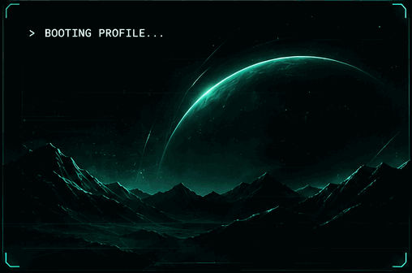

01 // IDENTITY
BUILDING INTELLIGENT SYSTEMS. ENGINEERING REAL PRODUCTS.

I'm Shivadarshan, a Computer Science student specializing in AI & ML. I'm interested in the intersection of artificial intelligence, full-stack engineering and product development — especially turning ideas into useful software.
<table>
<tr>
<td width="50%" valign="top">
FOCUS AREAS
- Artificial Intelligence & Generative AI
- LLM applications and RAG
- Full-stack product engineering
- Developer tools and automation
- Data structures and algorithms
</td>
<td width="50%" valign="top">CURRENTLY EXPLORING
- Python and FastAPI
- React and Next.js
- Machine Learning
- AI agents and retrieval systems
- Databases and system design
</td>
</tr>
</table>Build useful systems. Understand them deeply. Ship them.

02 // PROJECT SYSTEMS
Four products. Different problems. One engineering mindset.

<table>
<tr>
<td width="50%" valign="top">◈ ARCHON AI
Repository Intelligence

An AI-powered developer tool focused on understanding software repositories and making codebases easier to navigate and reason about.

AI LLMs RAG DEVELOPER TOOLS

Explore GitHub repositories ↗
</td>
<td width="50%" valign="top">◈ RECOVER PAY
Payment Recovery

A product focused on the payment-recovery problem and helping make outstanding-payment follow-up workflows more manageable.

PRODUCT PAYMENTS WORKFLOW

Explore GitHub repositories ↗
</td>
</tr>
<tr>
<td width="50%" valign="top">◈ AI RESUME ANALYZER
Resume Intelligence

An AI-powered application for analysing resumes and helping evaluate alignment with job opportunities.

PYTHON AI NLP ANALYSIS

Explore GitHub repositories ↗
</td>
<td width="50%" valign="top">◈ RADIUS CRM
Customer Relationship Management

A CRM product concept for organising customer information and managing business relationships and workflows.

CRM FULL STACK PRODUCT ENGINEERING

Explore GitHub repositories ↗
</td>
</tr>
</table>
03 // TECHNOLOGY STACK

04 // ENGINEERING ACTIVITY

Explore my repositories and recent work ↗

05 // CURRENT MISSION

<table>
<tr><td>┌──────────────────────────────────────────────────────┐
│                 SYSTEM OBJECTIVES                     │
├──────────────────────────────────────────────────────┤
│  01  Strengthen DSA and problem solving               │
│  02  Build production-minded full-stack applications  │
│  03  Explore GenAI, LLMs and retrieval systems         │
│  04  Improve backend and database engineering         │
│  05  Learn system design through practical projects   │
│  06  Turn useful ideas into real products             │
├──────────────────────────────────────────────────────┤
│                 STATUS: IN PROGRESS                  │
└──────────────────────────────────────────────────────┘
</td></tr>
</table>
06 // CONNECT
Have an interesting problem or an idea worth building? Let's connect.

SHIVADARSHAN HM // SYSTEM ONLINE

